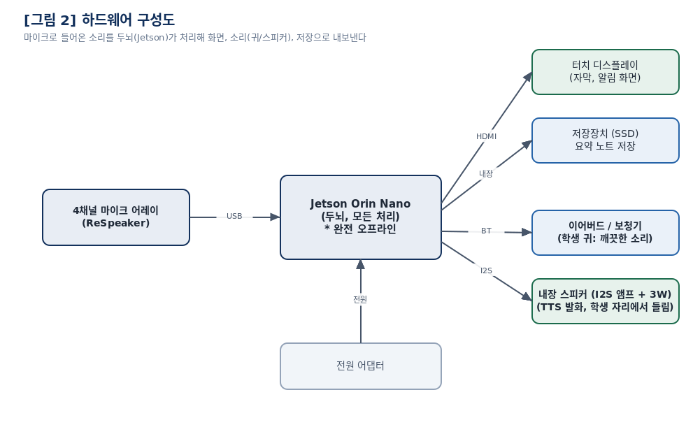
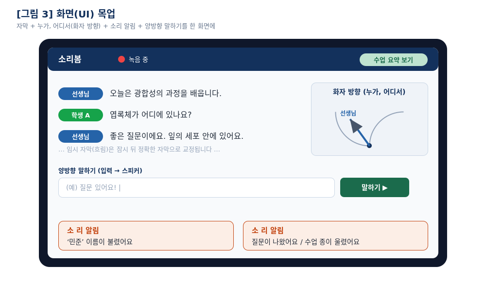

# 소리봄 (SoundSight)

> 청각장애 학생이 교실 수업을 놓치지 않도록 돕는, **인터넷 없이 작동하는** 교실용 청각 보조 단말기

**팀 제주 BTS (Beyond the Sound)** · 2026 제8회 한국코드페어 SW공모전 고등부

**현재 개발 현황 확인: 2026-10-15 · 통합 코드 `36edfef` (`main`), 시작 화면 개선은 `guhyeon` 작업 중.**
기능·수정 이력·남은 문제는 [통합 개발 로그](docs/conversation_log.md)의 최신 현황을 기준으로 봅니다.

---

## 우리가 풀려는 문제

청각장애·난청 학생은 교실에서 이런 어려움을 겪습니다.

- 여러 명이 동시에 말할 때 **누가, 어디서** 말하는지 알기 어렵다
- 선생님이 **이름을 부르거나, 종이 울리거나, 질문을 던져도** 놓치기 쉽다
- 수업 내용을 실시간으로 따라가기도, 끝나고 복습하기도 어렵다
- 하고 싶은 말이 있어도 **발화가 어려워 참여하지 못한다**

시중에도 자막 안경 같은 제품이 있지만 대부분 **인터넷 연결이 필요**합니다. 교실의 대화가
외부 서버로 나간다는 뜻이고, 학교 와이파이가 불안정하면 그대로 멈춥니다.

소리봄은 **음성 처리를 기기 안에서** 합니다. 자막·방향·말하기는 인터넷 없이 동작하며,
음성 녹음을 서버로 전송하지 않습니다. 사용자가 **노트 보내기**를 선택하면 수업 기록 텍스트를
지정한 이메일 주소로 전송합니다. 이 선택 기능에는 인터넷이 필요합니다.

## 여섯 가지 기능

| | 기능 | 현재 구현 |
|---|---|---|
| ① | **실시간 자막** | 영어 과목은 한국어/영어 자동 감지, 다른 과목은 한국어 전사. faster-whisper `small` 단일 패스·과목별 hotwords·환각 필터 |
| ② | **누가·어디서** | ReSpeaker 칩의 DOA 각도를 화살표로 표시. 화자의 신원을 식별하지는 않음 |
| ③ | **소리 알림** | 자막에 등록된 학생 이름이 포함되면 알림. 종소리·경보 등 비음성 분류는 미구현 |
| ④ | **깨끗한 소리 전달** | 이어버드·보청기로 수업 음성을 전달하는 기능은 미구현 |
| ⑤ | **수업 기록** | 전체 전사 기록 보기·30초 간격 자동 저장·종료 저장·이메일 본문 및 TXT 내보내기. 요약 기능은 아님 |
| ⑥ | **양방향 말하기** | sherpa-onnx + Supertonic v3로 한국어 합성, 시스템 기본 출력으로 재생 |

⑥은 학생 자리의 스피커에서 발화하는 구상입니다. I2S 스피커 제작을 시도했으나 정상 동작하지 않아
현재는 블루투스 스피커를 사용합니다. TTS 출력과 미구현 기능 ④의 수업 음성 전달은 별개입니다.

## 시스템 구조


그림은 초기 구상입니다. 현재 처리 흐름은 [시스템 설계](docs/02-system-design.md)를 참고하세요.

음성 처리는 NVIDIA Jetson Orin Nano 안에서 **완전 오프라인**으로 이뤄집니다.

## 노트 이메일 보내기

상단 **노트 보내기** → 받는 이메일 주소 입력 → 읽기 전용 기록 확인 → **보내기**를 누릅니다.
창을 연 시점까지의 기록이 본문과 TXT 첨부로 전송됩니다. 새로 들어오는 자막은 다음 전송에 포함됩니다.
최초 한 번 발송용 Gmail 설정이 필요합니다. [계정 설정과 테스트 안내](docs/15-note-email.md)를 참고하세요.

## 마이크 연결이 끊겼을 때

상단 상태 줄에서 마이크·방향 연결을 확인할 수 있습니다. ReSpeaker 연결이 끊기면
케이블을 다시 연결해주세요. 5초 간격으로 자동 재시도하며 **다시 연결**로 즉시 시도할 수도 있습니다.
다른 기본 마이크로 자동 전환하지 않습니다. 조용한 상태는 연결 끊김으로 판단하지 않습니다.

방향 장치 읽기만 실패하면 방향 화살표를 지우고 자막은 계속 처리합니다. 마이크 입력이
중단되면 새 자막을 멈추지만 기존 자막·수업 기록·노트 보내기·타이핑해서 말하기는 유지합니다.
끊긴 동안의 음성 및 끊긴 구간의 미완성 발화는 복구할 수 없습니다.

재연결 시 모델을 다시 로딩하지 않으며 녹음 프로세스는 하나만 실행합니다. 음성 큐는
100블록(약 3초), 발화 버퍼는 약 30초로 제한합니다. 처리가 밀려 큐가 가득 차면 오래된
대기 음성을 버리고 현재 음성부터 처리하므로 일부 자막이 누락될 수 있습니다.
설정은 `src/config.yaml`의 `audio`, `vad`, `doa`에서 변경합니다.

전사 대기 큐는 일반 4발화, 말하기 보관 중에는 32발화로 제한합니다. 기본적으로는
오래 기다렸다는 이유만으로 발화를 지우지 않습니다(`stt.queue_max_age_seconds: 0`).
큐 용량 초과와 선택적인 시간 제한에 따른 삭제는 진단에서 구분합니다.
저신뢰 전사의 온도 재시도는 `[0.0, 0.2]`, 복구 후보는 1개로 제한합니다. 첫 인식 경로는
그대로지만 어려운 음성의 복구 결과는 달라질 수 있어 재시험이 필요합니다.

자동 테스트: `QT_QPA_PLATFORM=offscreen .venv/bin/python -m unittest discover -s tests -v`
현재 코드의 자동 테스트 55개가 통과했습니다. 마이크 복구는 사용자가 실제 사용 테스트에서 정상 동작을
확인했고, 기록·말하기 개선도 테스트했다고 보고했습니다.
자동 테스트의 반복 재연결은 모의 녹음 프로세스를 사용합니다. 모델을 올린 상태의 장시간
메모리 검증은 별도로 필요합니다.

## 발화와 방향 연결

방향 워커가 주기적으로 모은 표본 중 실제 발화 중 읽은 값만 해당 자막에 연결합니다.
같은 방향의 연속 발화는 공백으로 이어 붙이고, 직전 발화와 방향이 5° 이상 달라지면
새 문단으로 표시합니다. `ui.caption_direction_break_degrees`로 기준을 조정할 수 있습니다.
359°→1°는 2° 차이로 계산합니다. 방향 미확정·장치 재연결 시에는 새 문단으로 구분하며,
30초 이상 공백은 기존처럼 빈 줄로 구분합니다. 화면은 최근 200문단·4만 글자까지 보관하며
전체 수업 기록의 발화별 저장 방식은 그대로입니다. 방향 변화는 화자 신원 판별이 아니므로
같은 사람의 이동도 문단을 나눌 수 있습니다.
전사 중 다음 화자가 말해도 앞 문장의 방향을 최신 각도로 바꾸지 않습니다. 표본이 부족하거나
방향이 크게 섞이면 화살표를 지우고 ‘미확정’으로 표시합니다. 기본 60초·602개로 보관을 제한하며
기존 재연결 처리를 유지합니다. 사용자가 실기기에서 예상대로 동작한다고 확인했습니다.
구현 범위와 실사용 확인은 [방향 연결 안내](docs/17-direction-timing.md)를 참고하세요.

## 실행 준비 화면

바탕화면 소리봄 아이콘은 중앙 로딩 창을 띄운 뒤 브라우저·Codex 데스크톱 앱·Codex CLI를
정상 종료해 메모리를 확보합니다. 다른 작업이 없는 Codex CLI의 터미널 셸만 닫고,
다른 터미널 탭과 작업은 유지합니다. 종료에 응답하지 않는 프로세스는 강제로 종료하지 않습니다.
로고 색상을 사용한 창에서 실제 모델 준비 단계와 움직이는 진행 표시를 보여주고,
모델 준비가 끝나면 메인 화면으로 전환합니다. 마이크·방향의 연결 상태는 메인 화면 상단에 표시합니다.
준비에 실패하면 같은 창의 **다시 준비하기** 버튼으로 재시도하거나 종료할 수 있습니다.

개발 도구를 유지하며 실행하려면 프로젝트 폴더에서 다음 명령을 사용합니다.

```bash
bash scripts/소리봄-실행.sh --keep-development-tools
```

직접 `.venv/bin/python src/main.py`로 실행해도 개발 도구를 종료하지 않습니다.
바탕화면 실행기는 터미널과 분리돼 개발 도구가 종료돼도 계속 실행됩니다.
개발 도구 정리 시간·미종료 수·전후 가용 메모리는 원문 없이 진단에 기록됩니다.

## 수업 기록 저장과 말하기

장시간 시험용 상태·메모리·처리 지연 로그는 `diagnostics/`에 자동 저장합니다(guhyeon 개발 중).
음성·자막 원문은 기록하지 않습니다. 시험 후 `.venv/bin/python scripts/analyze_diagnostics.py`로
요약할 수 있습니다. 사용 순서·한계는 [진단 기록 안내](docs/20-runtime-diagnostics.md)를 참고하세요.

기록은 기본 30초 간격으로 `notes/`의 같은 수업 파일에 갱신하며, 정상 종료 시 마지막 내용도
저장합니다. 실행마다 고유한 파일명을 사용합니다. 상단에서 저장 시각이나 실패 안내를 확인할
수 있습니다. 저장 실패 시 이전 저장본과 메모리의 기록을 유지하고 다음 주기에 다시 시도합니다.
강제 종료 시 마지막 저장 이후의 내용은 유실될 수 있습니다. 이전 TXT 파일은 파일 관리자로
열 수 있으며, 앱에서 이전 수업을 자동으로 불러오지는 않습니다.
기록 보기·저장 TXT·이메일 본문에는 날짜의 요일과 선택한 과목을 함께 표시합니다.
수업 중 과목을 바꾸면 이후 발화부터 새 과목으로 기록하고, 여러 과목은 구간별로 표시합니다.

말하기는 합성·재생 중 재전송 버튼을 잠그지만 다음 문장은 계속 입력할 수 있습니다. 성공한 뒤
입력 내용이 그대로일 때만 지웁니다. 실패하면 입력을
유지하므로 스피커 연결·시스템 출력을 확인한 뒤 다시 말하기를 누르세요. 한 번에 200자까지
입력하며 긴 문장은 나눠 말합니다. BT 연결 관리와 기본 출력 선택은 운영체제에서 합니다.
설정은 `summary.autosave_seconds`, `tts.max_chars`입니다.
실기기 확인 순서는 [기록·말하기 테스트 안내](docs/16-recording-speech-stability.md)를 참고하세요.

말하기와 유튜브 등 모든 소리에서 지지직거린다면 OS의 블루투스 연결을 끊고 같은 스피커에
다시 연결해 보세요. 이번 재현에서는 순수 톤·GPU/CPU 음성·유튜브에 공통 잡음이 있었고,
스피커 재연결 후 사용자가 깨끗해졌다고 확인했습니다. 페어링 삭제나 초기화는 필요하지 않았습니다.





위 하드웨어 그림과 UI 목업은 초기 자료로, 현재 스피커 구성·상단 버튼·연결 상태 안내와 다릅니다.

## 기술 스택

| 영역 | 선택 | 이유 |
|---|---|---|
| 연산 | NVIDIA Jetson Orin Nano (67 TOPS) | 엣지에서 STT를 실시간으로 돌릴 수 있는 최소 사양 |
| 수음 | ReSpeaker Mic Array v3.0 (XMOS XVF-3000) | 빔포밍·DOA·에코제거를 칩에서 처리 → Jetson 부담 경감 |
| 실행 환경 | 프로젝트 `.venv`, Python 3.10.12 | 현재 Jetson에서 확인한 실행 환경 |
| 음성 인식 | faster-whisper, CUDA CTranslate2, int8 | `small` 단일 패스. medium은 공유 메모리 제약으로 제외 |
| 음성 구간 검출 | faster-whisper 내장 Silero VAD(ONNX) | 앱의 VAD는 torch 없이 실행 |
| 음성 합성 | sherpa-onnx + Supertonic v3 int8 | CUDA 빌드 사용, TTS GPU 초기화 실패 시 CPU 대체 |
| 음성 출력 | 시스템 기본 출력 (`output_device: null`) | 현재 블루투스 스피커 사용 |

## 문서

- **[통합 개발 로그 — 최신 현황·수정 이력·남은 문제](docs/conversation_log.md)** ← 팀원은 여기부터
- [Day 1 — 초기 작업 계획](docs/Day1.md) (7월 기록)
- [개발 환경 설치 — macOS](docs/00-setup-mac.md) / [Windows](docs/00-setup-windows.md)
- [SSD 설정 (Jetson)](docs/11-ssd.md)
- [문제 정의](docs/01-problem.md)
- [시스템 설계](docs/02-system-design.md)
- [하드웨어 구성과 배선](docs/03-hardware.md)
- [이해도 실험 설계](docs/04-experiment.md)
- [안전 관리](docs/05-safety.md)
- [부품 리스트 (BOM)](hardware/BOM.md)

## 효과 검증

"자막이 나오니 좋아 보인다"에서 그치지 않고, **숫자로 증명**합니다.

같은 학생이 난이도가 비슷한 두 수업을 각각 *단말 사용* / *미사용* 조건으로 듣고 이해도 퀴즈를 봅니다
(조건 순서는 무작위 배정). 대응표본 t-검정으로 점수 차이를 검정하고, 95% 신뢰구간과
효과크기(Cohen's d_z)를 함께 보고합니다. 자세한 설계는 [docs/04-experiment.md](docs/04-experiment.md).

## 안전

- 실제 보청기·인공와우에 큰 소리를 직접 보내는 실험은 **하지 않습니다**
- 모든 음량은 디지털 소음계로 상한을 확인합니다
- 모의 저청력 조건(노이즈캔슬링)은 **안전한 크기, 짧은 시간**으로만 재현합니다

## 개발 현황

- [x] 문제 정의 · 시스템 설계
- [x] 하드웨어 선정 · 부품 확보
- [x] ReSpeaker 수음 → VAD → `small` 단일 패스 자막
- [x] DOA 화살표·자막·타이핑 말하기 UI 통합
- [x] 과목별 용어 사전·이름 호명 알림·환각 방어 필터
- [x] 밝은/어두운 테마·대화 공백 구분
- [x] 전체 전사 기록 보기·30초 자동 저장·종료 저장·파일명 충돌 방지
- [x] 노트 이메일 발송 구현·자동 테스트·실제 UI 확인
- [x] 마이크/방향 오류 분리·자동/수동 재연결·음성 버퍼 제한
- [x] 말하기 중복 방지·출력 오류 안내·실패 시 입력 보존
- [x] 기록의 요일·과목 표시와 과목 변경 구간 보존
- [x] 관련 자동 테스트 55개 통과·사용자의 마이크 복구 작업 정상 동작 확인
- [ ] 실제 Gmail 인증·본문/TXT 수신 확인
- [ ] GPU 모델 동시 사용 상태의 장시간 안정성 검증
- [ ] 비음성 소리 분류·수업 음성의 이어버드 전달
- [ ] 새 자동 저장·말하기 보호 기능의 실기기 테스트
- [x] 발화 시점과 방향 표본의 연결 개선 (실기기 정상 동작 확인)
- [ ] 교대 발화·짧은 발화·재연결의 새 방향 표시 실기기 확인
- [ ] 이해도 실험 전체 결과 확인·통계 분석 완료 여부 검증

이메일 구현 완료는 실제 수신 검증 완료를 뜻하지 않습니다. 과거 측정값의 조건과 한계는
[측정 기록](docs/phase_c_measurements.md)에 정리되어 있습니다.

## 라이선스

MIT License. [LICENSE](LICENSE) 참고.
