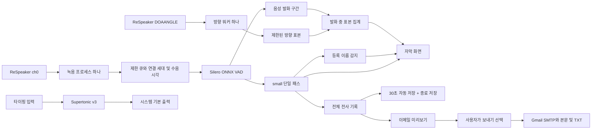
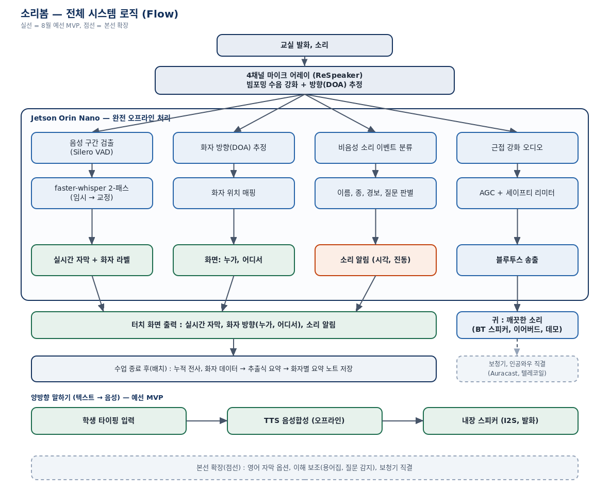

# 2. 시스템 설계

> 최신 대조: 2026-10-11 · 기록·말하기 기준 `521776d` + 발화 시점과 방향 연결 개선.
> 개발·수정 이력과 남은 문제는 [통합 개발 로그](conversation_log.md)를 참고합니다.

## 설계 원칙

1. 자막·방향·말하기는 Jetson 내부에서 오프라인으로 처리합니다. 노트 이메일만 사용자가 전송할 때 인터넷을 사용합니다.
2. 음성인식은 `small` 단일 패스입니다. 초기 small→medium 2-패스는 메모리 제약과 비교 측정으로 폐기했습니다.
3. 마이크·방향 오류를 분리합니다. 재연결 시 모델을 유지하고 장치 자원과 끊긴 구간의 버퍼만 정리합니다.

## 현재 처리 흐름

### 수음과 자막

ReSpeaker는 USB에서 6채널 입력으로 보이며, 칩이 처리한 ch0만 모노 16kHz로 사용합니다.
VAD는 faster-whisper에 내장된 Silero ONNX 모델을 재사용하므로 앱 실행에 torch가 필요하지 않습니다.
`small` 모델은 CUDA/int8로 한 번 로딩합니다. 공통·과목별·등록 이름 hotwords와 저신뢰/용어 나열
필터를 적용하며 과목 변경 시 모델은 재로딩하지 않습니다. 임시 자막→교정 단계는 없습니다.

### 화자 방향

XMOS 칩이 계산한 검증된 DOAANGLE만 읽습니다. 화면 각도는 `(front_offset - raw) % 360`으로
변환합니다. 현재 front_offset은 90입니다. 방향 워커가 기본 0.1초 간격으로 원본을 읽고,
수음 시각에서 만든 VAD의 음성 구간에 포함된 표본만 집계합니다. 이전 발화의 EMA를 이어 쓰지
않으며, 최소 2개 표본의 70% 이상이 ±30도에 모여야 방향을 표시합니다. 표본 부족·상충은
미확정으로 표시합니다. 기본 60초·602개로 보관을 제한하며 새 방식의 실기기 확인은 남았습니다.
방향 표시는 화자의 신원·화자별 라벨을 식별하지 않습니다.

### 이름 호명과 미구현 기능

이름 호명은 자막에 등록된 이름이 포함되는지 검사합니다. 별도 오디오 분류 모델은 없습니다.
종소리·경보 등 비음성 소리 분류와, 수업 음성을 이어버드/보청기로 전달하는 기능은 미구현입니다.
초기 구상의 '4개 오디오 레인 병렬 처리'를 현재 구현으로 설명하지 않습니다.

### 타이핑 말하기

입력 → sherpa-onnx + Supertonic v3 int8 합성 → sounddevice로 시스템 기본 출력 재생입니다.
현재 블루투스 스피커를 사용하며 `output_device: null`입니다. GPU 초기화 실패 시 TTS는 CPU로
대체합니다. STT 장치 설정은 별도이며 자동 CPU 대체는 구현되어 있지 않습니다.
합성·재생은 한 번에 하나만 실행하고 작업 중 입력·버튼을 잠급니다. 성공 시 입력을 지우고
실패 시 출력 확인 안내와 원문을 남깁니다. 출력 오류 시 스트림을 정리해 재시도할 수 있습니다.
기본 200자 제한을 넘으면 문장 분할을 안내합니다. OS의 BT 연결 관리·출력 자동 전환 감지는 별도입니다.

### 기록과 이메일

전체 발화를 공백·문장 끝·연속 중복만 정리해 보여주고 기본 30초 간격 및 정상 종료 시 저장합니다. 추출식 요약이나
화자별 요약은 제공하지 않습니다. 기록 복사 시 잠금을 사용해 자막 추가와 미리보기를 함께 처리합니다.
저장 워커 하나가 실행별 고유 파일을 갱신합니다. 권한 600 임시 파일을 fsync 후 교체하며,
실패하면 이전 파일을 유지하고 화면에서 안내합니다. 저장 도중 새 자막은 다음 저장에 포함됩니다.
강제 종료 시 마지막 저장 이후의 내용은 유실될 수 있고 이전 수업 TXT의 자동 불러오기는 없습니다.
헤더에 날짜·요일·과목을 표시하고, 과목 전환 시 이미 기록한 발화의 과목을 유지합니다.
여러 과목은 같은 수업 파일에서 구간별 제목으로 구분합니다.

이메일 창을 열면 그 시점의 기록 스냅샷을 고정합니다. 사용자가 보내기를 누르면 별도 전송
스레드가 동일한 한글 본문과 TXT 첨부를 Gmail SMTP/TLS로 전송합니다. 수신 주소는 저장하지
않고, 계정 설정은 Git에서 제외한 `.email.local.ini`(권한 600)에 둡니다. 음성 녹음은 보내지 않습니다.
실제 Gmail 인증·수신 확인은 아직 기록되지 않았습니다. [이메일 안내](15-note-email.md)를 참고하세요.

## 장치 복구와 자원 제한

- 마이크와 방향 워커를 하나씩 유지하고 녹음 프로세스도 최대 하나만 실행합니다.
- USB 재연결 시 녹음 프로세스를 교체해 입력 장치 목록을 다시 읽습니다. TTS의 PortAudio와 모델은 재초기화하지 않습니다.
- 작은 오디오 프레임은 제한된 파이프로 보냅니다. 파이프가 차면 콜백에서 기다리지 않으며, 음성 큐도 100블록으로 제한합니다.
- 약 30초마다 긴 발화를 나눕니다. 연결 세대가 바뀌면 VAD 버퍼를 초기화하고 진행 중인 이전 세대 전사 결과를 버립니다.
- 방향 읽기는 별도 워커와 300ms USB 제한으로 수음·STT를 막지 않습니다.
- 자동 재시도는 5초 간격이고 수동 버튼도 같은 워커에 요청합니다. 다른 기본 마이크로 자동 전환하지 않습니다.
- 오디오 수신 중단은 2초, 초기 연결 대기는 5초로 감지합니다. 소리 크기가 0이라는 이유로 연결 끊김으로 판단하지 않습니다.

끊기거나 과부하로 버린 음성은 복원할 수 없습니다. 관련 한도는 `src/config.yaml`에서 조정합니다.

## 화면과 검증

전체화면에 자막·방향·말하기·과목·기록/이메일 버튼·연결 상태를 배치합니다. 밝은/어두운 테마와
긴 대화 공백 구분을 제공합니다. 모델 준비 중에도 화면을 유지하며, 방향 실패 시 오래된 화살표를
지우고 마이크 입력 실패 시 기존 기록과 다른 기능을 유지합니다.

현재 코드의 자동 테스트 55개가 통과했고 마이크 복구는 사용자 정상 동작 확인이 있습니다. 새 기록·말하기
보호 기능은 모의 테스트와 밝은/어두운 화면 확인을 마쳤고 사용자도 테스트했다고 보고했습니다. 방향 개선도 실기기 정상 동작 확인을 받았습니다. 모의 프로세스 반복 재연결은 검증했지만
실제 GPU 모델·장치를 포함한 장시간 안정성은 별도 시험이 필요합니다. 지연·정확도의 과거 수치는
[측정 기록](phase_c_measurements.md)의 조건과 한계를 함께 읽습니다.

위 그림은 초기 2-패스·4레인 구상으로 현재 구현과 다릅니다. UI 목업도 실제 화면의 최신 상태를
보장하지 않습니다.

## 용어

| 용어 | 뜻 |
|---|---|
| STT | 음성을 글자로 변환 |
| TTS | 글자를 음성으로 합성 |
| VAD | 사람의 발화 구간 감지 |
| DOA | 소리가 들어오는 방향 |
| hotwords | 인식 후보에 수업 용어 힌트를 제공 |
| 연결 세대 | 재연결/버퍼 초기화 전후 음성과 전사 결과를 구분하는 번호 |
