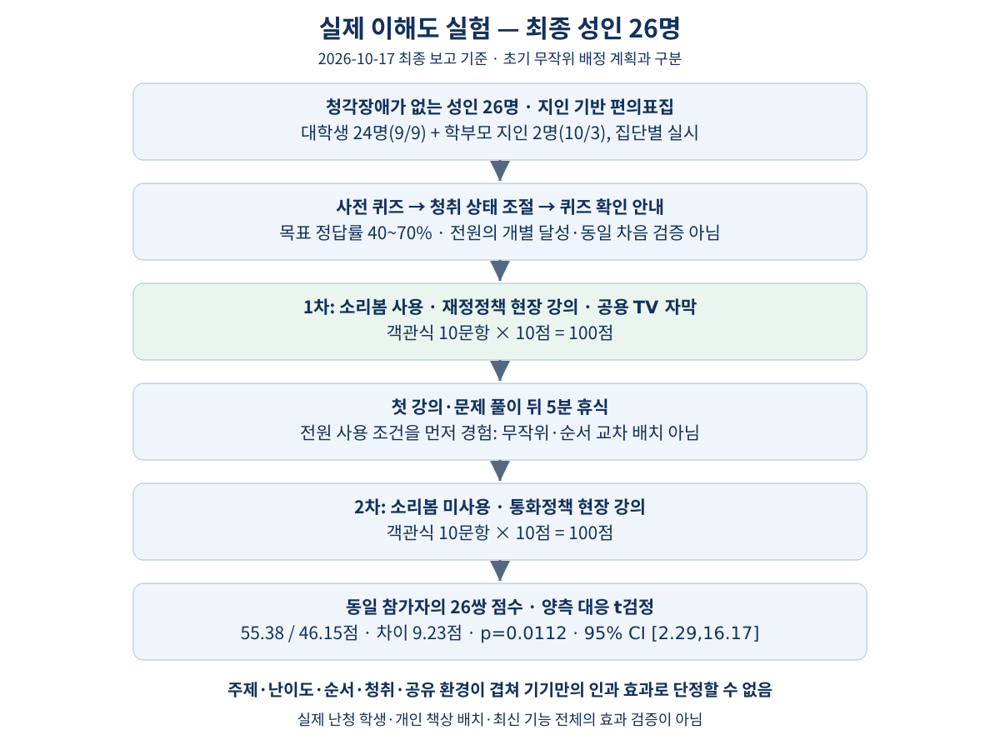

# 4. 소리봄 이해도 실험 — 최종 26명 결과와 해석
작성 기준: 2026년 10월 17일
최종 분석 대상: 26명
사전 청취 조절 목표 정답률: **40~70%** (이전 30~60% 안내를 정정)

## 1. 핵심 결과

소리봄 사용 조건의 평균 점수는 **55.38점**, 미사용 조건은 **46.15점**이었다. 같은 참가자의 두 점수를 비교한 평균 차이는 **9.23점**이었다.

양측 대응표본 t검정 결과는 **t(25)=2.739, p=0.0112**이며, 평균 차이의 95% 신뢰구간은 **2.29~16.17점**이었다.

다만 두 조건은 강의 주제와 시행 순서가 달랐다. 따라서 관찰된 점수 차이를 소리봄만의 인과적 효과로 해석할 수 없다. 청각장애가 없는 성인을 대상으로 한 탐색적 실험 결과이다.

## 2. 실험 목적

청취가 어려운 상황에서 소리봄의 실시간 자막을 함께 보는 조건과 자막 없이 듣는 조건의 강의 이해도 점수를 비교했다. 실제 청각장애 학생에 대한 효과나 최신 버전의 모든 기능을 검증한 실험은 아니다.

## 3. 참가자와 진행 장소

- 총 26명이며 모두 성인이고 청각장애가 없다.
- 2026년 9월 9일: 제주대학교 공과대학 강의실에서 대학생 24명 참여.
- 2026년 10월 3일: 한신더휴 아파트 커뮤니티 건물 도서관에서 학부모 지인 2명 참여.
- 대학생은 팀원 가족 중 해당 대학에 재학 중인 학생을 통해, 나머지 2명은 학부모의 지인을 통해 모집했다.
- 확률표집이 아닌 지인 기반 편의표집이다.
- 각 집단은 함께 실험에 참여했다.

## 4. 청취 상태의 사전 조절

1. 모의 난청 상황 퀴즈 1을 진행했다.
2. 참가자가 자신의 청취 상태를 조절하도록 안내했다. 목표 정답률은 **40~70%**였다.
3. 퀴즈 2로 조절한 상태를 다시 확인하도록 했다.
4. 두 본 실험 강의 동안 조절한 청취 상태를 그대로 유지했다.

40~70%는 사전 안내 목표이며, 모든 참가자가 실제로 해당 범위에 도달했다는 개별 검증 결과를 의미하지 않는다. 이 사전 퀴즈의 정답률은 본 실험에서 분석한 두 강의의 이해도 점수와 구분한다.

귀마개·ANC 등의 사용 유형과 차음 정도는 참가자별로 구분하여 기록하지 않았다. 실제 청각장애의 다양한 청취 특성을 재현했다고 볼 수 없으며, 청취 상태가 참가자 사이에서 동일하게 표준화되었다고도 보기 어렵다.

## 5. 본 실험 절차와 평가

모든 참가자가 아래의 동일한 순서로 참여했다.

1. **소리봄 사용 조건:** 재정정책 현장 강의를 듣고 객관식 이해도 평가 실시.
2. **휴식:** 첫 강의와 문제 풀이 후 5분.
3. **소리봄 미사용 조건:** 통화정책 현장 강의를 듣고 객관식 이해도 평가 실시.

- 강의는 녹화·녹음 재생이 아닌 현장 발화였다.
- 사용 조건에서는 HDMI로 연결한 공용 TV 화면에서 자막을 보았다. 참가자마다 개인 모니터를 사용한 실험은 아니다.
- 이해도 평가는 강의별 객관식 10문항, 문항당 10점, 총 100점이다.
- 부분 점수와 사후 채점 정정은 없었다.
- 강의 스크립트의 목표 시간은 약 5분이지만, 실제 진행 시간의 정밀 측정값은 남아 있지 않다.
- 순서를 무작위 배정하거나 두 순서를 교차 배치하지 않았다.

## 6. 분석 데이터 구성

최종 분석은 같은 참가자의 사용·미사용 점수 **26쌍**이다. 기존 23쌍에 누락된 대학생 1명과 학부모 지인 2명을 추가했다. 대학생 총 24명, 학부모 지인 2명이다. 개인별 점수·동의서·식별정보는 이 문서에 싣지 않는다.

이전 23명·잠정 25명 결과는 과거 이력이며 최종 발표에는 26명 결과만 사용한다.

## 7. 기술통계

점수의 단위는 100점 만점에서의 점수이며, 표준편차는 표본 표준편차이다.

- 소리봄 사용 조건: 평균 **55.3846점**, 표준편차 **18.3806점**, n=26.
- 소리봄 미사용 조건: 평균 **46.1538점**, 표준편차 **16.7516점**, n=26.
- 개인별 차이의 평균: **9.2308점** (사용 점수 − 미사용 점수).
- 사용 조건에서 점수가 더 높은 참가자: **14명**.
- 두 조건의 점수가 같은 참가자: **5명**.
- 사용 조건에서 점수가 더 낮은 참가자: **7명**.

평균 차이 9.23점은 두 조건의 점수 차이이며, 모든 참가자가 개선되었다는 의미는 아니다. 점수 차이를 곧바로 인식 정확도 향상률이나 학습 효과 증가율로 표현하지 않는다.

## 8. 통계 분석 방법과 결과

### 대응표본 t검정

같은 참가자가 두 조건에 모두 참여했으므로, 두 집단을 독립표본으로 처리하지 않고 개인별 대응 차이를 이용했다.

- 차이 정의: dᵢ = 사용 조건 점수ᵢ − 미사용 조건 점수ᵢ
- 귀무가설 H₀: 모집단의 평균 대응 차이가 0이다.
- 대립가설 H₁: 모집단의 평균 대응 차이가 0이 아니다.
- 양측 검정, 해석 기준 유의수준 0.05.
- 검정통계량: t = 평균(d) / [표준편차(d) / √n]
- 자유도: n − 1 = 25

분석 결과:

- t = **2.7386128**
- 자유도 = **25**
- 양측 p-value = **0.0112074**
- 평균 차이 = **9.2307692점**
- 평균 차이의 95% 신뢰구간 = **[2.2888879, 16.1726506]점**

발표·문서용 반올림 표기는 **t(25)=2.739, p=0.0112, 평균 차이 9.23점, 95% CI [2.29, 16.17]**이다.

### 해석 시 유의할 점

유의수준 5%에서는 두 조건의 평균 점수 차이가 관찰되었다. p-value가 0.0112라는 것은 소리봄의 효과가 참일 확률이 98.88%라는 뜻이 아니다. 귀무가설과 검정 가정 아래에서 현재와 같거나 더 극단적인 검정통계량을 얻을 확률에 관한 값이다.

대응표본 t검정은 참가자 간 대응 차이의 독립성과 차이 분포에 관한 가정에 의존한다. 본 문서는 별도의 정규성·이상치 진단이나 비모수 민감도 분석을 수행했다고 주장하지 않는다. 두 집단이 공용 화면과 같은 강의를 함께 경험했다는 점도 해석에 고려해야 한다.

통계적 유의성은 강의 주제·난이도·시행 순서 등 설계상의 혼입을 제거하지 않는다.

## 9. 주요 한계

1. **대상자 차이:** 청각장애 당사자가 참여하지 않았다. 실제 청각장애 학생에게 같은 결과가 나타난다고 일반화할 수 없다.
2. **강의와 문항 차이:** 사용 조건은 재정정책, 미사용 조건은 통화정책이었다. 주제 지식과 문항 난이도 차이의 영향을 분리하지 못했다.
3. **고정된 순서:** 전원이 사용 조건을 먼저 경험했다. 연습·피로·적응·순서 효과가 개입할 수 있다.
4. **표집과 규모:** 지인 기반 편의표집 26명으로, 대표성에 제한이 있다.
5. **청취 조건의 개인차:** 목표 정답률은 안내 범위이며, 차음 도구와 차음 정도를 개인별로 충분히 기록하지 않았다.
6. **공용 화면:** 개인 책상에서 기기를 사용하는 최종 활용 방식과 실험 환경이 다르다.
7. **두 날짜·장소:** 24명과 2명이 서로 다른 날짜·장소에서 참여해 음향·좌석·화면 가시성 등의 차이가 남아 있다.
8. **최신 기능의 검증 범위:** 영어 전사, 자동 저장, 이메일 등 예선 이후 추가·개선한 기능 전체의 효과를 검증한 결과가 아니다.
9. **측정 범위:** 이해도 점수 비교이며, 음성 인식 정확도·지연 시간·방향 정확도를 정량 측정한 시험이 아니다.

## 10. 문서와 발표에 사용할 수 있는 결론

> 청각장애가 없는 성인 26명을 대상으로 청취가 어려운 상황에서 두 강의 조건을 비교한 결과, 소리봄 사용 조건의 평균 점수는 55.38점으로 미사용 조건의 46.15점보다 9.23점 높았다. 양측 대응표본 t검정 결과는 t(25)=2.739, p=0.0112였다. 다만 강의 주제와 시행 순서가 함께 달라, 이 차이를 소리봄만의 효과로 단정할 수 없다. 향후 청각장애 당사자의 참여와 순서·난이도를 통제한 실제 교실 검증이 필요하다.

피해야 할 표현:

- “청각장애 학생의 학습 효과를 입증했다.”
- “소리봄 때문에 점수가 9.23점 향상되었다.”
- “모든 참가자에게 효과가 있었다.”
- “인식률이 9.23% 개선되었다.”
- “p-value로 제품의 실용성이 증명되었다.”

## 11. 후속 검증 방향

- 청각장애 당사자의 의견을 듣고 사용 환경과 요구를 반영한다.
- 난이도가 유사한 강의·문항을 마련하고 조건 순서를 무작위 배정하거나 교차 배치한다.
- 청취 조절 도구, 사전 퀴즈 결과, 좌석·거리·소음 조건을 기록한다.
- 실제 개인 책상 배치에서 자막 가독성, 질문 입력, 기록 확인을 검증한다.
- 인식 오류율과 지연, 방향 표시 오차, 장시간 사용 안정성을 별도로 측정한다.

## 12. 자료 출처와 수정 이력

- `소리봄실험동의서_정리.xlsx`: 기존 23쌍 점수의 기준 자료.
- 2026년 10월 17일 사용자가 확정한 추가 3쌍과 최종 참가자 구성.
- 재정정책·통화정책 강의 스크립트 및 객관식 퀴즈.
- `소리봄동의서_261017_203701.pdf`: 연구 안내에 목표 정답률 40~70% 명시.
- 최종 26명 분석 기록: `final26_stats.json`.
- 정정: 참가자 수 26명(대학생 24명, 학부모 지인 2명), 사전 목표 정답률 40~70%.
- 사전 목표 범위의 정정은 본 실험 점수의 수정이 아니므로, 평균·표준편차·t검정·신뢰구간은 변하지 않는다.

이 문서에는 참가자 식별정보와 개인별 원점수를 싣지 않는다. 동의서와 원점수는 별도로 관리한다.

## 13. 현재 문서와 과거 자료 구분

- 현재 통계 기준: 2026-10-17 사용자가 제공한 `소리봄_실험결과_통계분석_26명_2026-10-17.md`.
- 원자료 3쌍 추가 후 평균·SD·대응 t검정·신뢰구간을 재계산해 제공 보고서와 일치를 확인했다.
- 기존 23명 v2 자료와 그 이전 정정 전 자료는 과거 이력으로 보존한다. 현재 수치로 인용하지 않는다.
- 초기 계획의 무작위 순서·동급생·보호자 동의·마스킹·단측 검정·Cohen's d_z는 실제 실시나 최종 분석으로 설명하지 않는다.
- `experiments/analysis.py`는 초기 단측·효과크기 분석 예제이며 최종 26명 보고서를 재현하는 현재 분석기가 아니다. 최종 값은 위 양측 대응 t검정 기준이다.
- 원 시험지·채점표·누락 참가자 포함 근거와 동의서의 관리·보관 상태는 별도로 점검한다. 사후 채점 정정 없음과 자료 전사/누락 정정은 구분한다.
- 과거 제출용 PDF·DOCX·PPTX와 초기 실험 도면은 제출 당시 기록이다. 새 발표에는 이 문서와 최신 편집본을 기준으로 한다.

## 14. 실제 실시 흐름

[SVG 원본](figures/experiment-final26.svg). 초기 `figures/experiment.svg/png`는 실제와 다른 계획도이므로 현재 설계 그림으로 사용하지 않는다.
