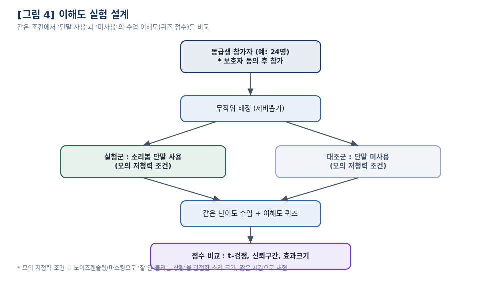

# 4. 이해도 실험 설계

## 2026-10-16 수정 점수 기준 분석 v2 — 현재 인용 기준

사용자가 image.png로 원자료 오류를 정정했다. 이전 v1의 평균 73.91점, 차이 27.83점,
p=4.844e-12 및 관련 효과크기/보조 검정은 수정 전 자료에 근거하므로 더 이상 인용하지 않는다.
원본 XLSX는 덮어쓰지 않았으며 수정 이미지를 별도 전사·검산했다(1차 점수 11개 행 변경).

동일 23명이 1차 기기 사용·재정정책·먼저, 2차 미사용·통화정책·나중 조건에 참여했다.
두 시험은 100점 만점이며 대응 여부는 사용자 확인에 따른다. 대부분 3M 이어플러그,
일부 노이즈캔슬링 이어폰을 사용했다. 실제 난청 학생 대상은 아니고 편의표집이 일부 사용됐다.
수업 함도유 / 데이터 정리 강구현 / 데이터 분석 강주언.

수정 후 평균 57.39점 대 46.09점(합계 1,320/1,060점), 대응 평균 차이 +11.30점,
차이 표본 SD=17.14, 표준오차=3.5733, 양측 대응 t(22)=3.1636, p=0.004502,
평균 차이 95% CI=3.89~18.71점. 1차가 높은 사람 14명, 동점 4명, 낮은 사람 5명이며
동점도 검정에서 제외하지 않는다. 이번 분석은 사용자 요청에 따라 대학 1학년 수준의
기술통계·대응 t검정·신뢰구간만 사용한다. 효과크기 지수와 비모수 검정 등은 사용하지 않는다.

통계 가정 아래 두 수업 조건의 차이는 유의하지만 기기·주제·순서가 완전히 겹쳐
기기만의 인과 효과나 실제 난청 학생에 대한 효과를 입증하지 못한다. 순서 고정이
학습 편향 제거 또는 보수적 효과 추정을 보장하지도 않는다. 차음 장비 혼용·시험 난이도
동등성·편의표집·기대/채점 편향·동일 수업의 관측 독립성도 한계다.

본선 서류 작성은 Git 제외 `experiments/data/codefair_2026-10-16_v2/`의
analysis.json·corrected_scores.csv·build_materials.py·수정본 PDF/Word/엑셀을 참고한다.
열람 사본: `/home/soribom/Downloads/소리봄_실험분석_2026-10-16_수정본/`.
이전 v1 자료는 수정 전 이력으로만 보존하며 해당 폴더에 사용 금지 안내를 추가했다.
원 시험지·채점표로 수정 사유와 점수를 최종 검산해야 한다.

## 아래 내용은 초기 계획이며 실제 실시 확인 자료와 구분

## 연구 질문

> 소리봄 단말을 사용하면, 잘 들리지 않는 상황에서 수업 이해도가 올라가는가?

- **귀무가설 H₀** : 단말 사용 여부에 따른 이해도 퀴즈 점수 차이가 없다 (μ_d = 0)
- **대립가설 H₁** : 단말 사용 시 점수가 더 높다 (μ_d > 0)

## 설계 — 대응표본(within-subject)

같은 학생이 **두 조건을 모두** 경험합니다.

| 조건 | 내용 |
|---|---|
| 실험 | 모의 저청력 + **소리봄 단말 사용** |
| 대조 | 모의 저청력 + 단말 미사용 |

**왜 대응표본인가.** 학생마다 원래 이해력이 다릅니다. 서로 다른 두 집단을 비교하면
그 개인차가 잡음이 되어 진짜 효과를 가립니다. 같은 학생을 두 번 재면 개인차가 상쇄되어
훨씬 적은 인원으로도 효과를 잡아낼 수 있습니다.

**순서 균형(counterbalancing).** 조건 순서(단말 먼저 / 나중)를 무작위로 배정해
학습 효과와 피로 효과를 상쇄합니다. 두 수업은 난이도가 비슷한 별개 주제를 씁니다.

## 표본 크기

검정력 분석 결과:

| 항목 | 값 |
|---|---|
| 기대 효과크기 (Cohen's d_z) | 0.6 (중간~큰 효과) |
| 유의수준 α | .05 (단측) |
| 검정력 (1−β) | .80 |
| **필요 표본 n** | **≈ 24명** |

## 모의 저청력 조건

노이즈캔슬링 헤드폰과 마스킹 소음으로 "잘 안 들리는 상황"을 재현합니다.
**안전한 음량, 짧은 시간**으로만 진행하며 소음계로 상한을 확인합니다.
불편하면 언제든 중단할 수 있습니다.

## 분석

| 지표 | 방법 |
|---|---|
| 효과 검정 | 대응표본 t-검정 (paired t-test) |
| 불확실성 | 평균 차이의 95% 신뢰구간 |
| 효과 크기 | Cohen's d_z |
| 보조 지표 | STT 정확도 (WER), 자막 지연 시간 |

p값 하나만 보고하지 않습니다. **신뢰구간과 효과크기**를 함께 보고해야
"통계적으로 유의하다"가 아니라 "실제로 얼마나 도움이 되는가"를 말할 수 있습니다.

분석 코드: [`experiments/analysis.py`](../experiments/analysis.py)

## 윤리

- 모든 참가자에게 보호자 동의를 받습니다 (연구참가 동의서)
- 실험 데이터는 **익명**으로만 기록합니다 (익명 번호, 학년, 성별, 퀴즈 점수)
- 이름·소속은 동의 확인용으로만 쓰고 연구 종료 직후 폐기합니다
- 원자료는 이 저장소에 커밋하지 않습니다 (`.gitignore`로 차단)
